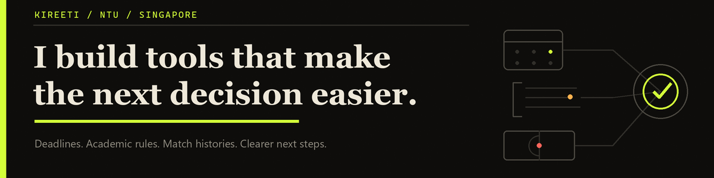
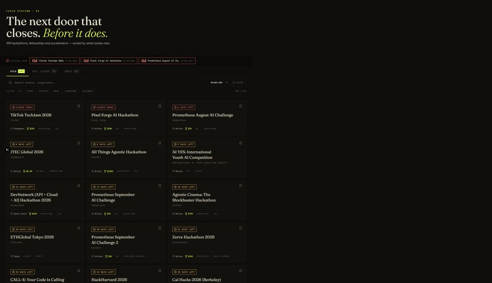

  <picture>
    <source media="(max-width: 600px)" srcset="./assets/profile-banner-v2-mobile.png" />
    
  </picture>

  <strong>Hi, I’m Kireeti—an NTU student in Singapore.</strong> 
  I turn messy information into tools people can inspect, test, and use.

<a href="https://github.com/KIREETI001/HackOrg"><strong>See the flagship →</strong></a>

## What closes next—and is it worth applying for?

### [HackOrg](https://github.com/KIREETI001/HackOrg)

*Authentic local capture using the repository’s committed 22 Aug 2026 data.*

A deadline-first scanner for hackathons, fellowships, and accelerators. It turns a daily scan into a focused view of what is closing soon, with local bookmarks and a warning if the data stops updating.

**Proof snapshot · 22 Aug 2026:** 319 records indexed · latest 12 scheduled scans passed 
[Code](https://github.com/KIREETI001/HackOrg) · [Latest scan](https://github.com/KIREETI001/HackOrg/actions/workflows/daily-scan.yml) · [Dataset status](https://github.com/KIREETI001/HackOrg/blob/main/data/meta.json)

## Two more decisions I’m exploring

- **Can a student trust the rule?** [NTU Academic & Career Co-Pilot](https://github.com/KIREETI001/NTU-EEE-Copilot) is an unofficial EEE planning prototype with a versioned rulebook, source provenance, and confidence labels. [Main CI](https://github.com/KIREETI001/NTU-EEE-Copilot/actions/runs/27670899152) passed 50 tests, rulebook checks, and a Next.js build.
- **Does the forecast survive honest testing?** [World Cup Oracle](https://github.com/KIREETI001/FIFA) combines World Football Elo with a Dixon–Coles scoreline model. Its walk-forward evaluation trains only on matches available before each prediction.

## Now

I’m studying at NTU, maintaining HackOrg’s daily scan, and learning how to make planning and forecasting tools easier to verify.

## Build with me

Found a [stale listing](https://github.com/KIREETI001/HackOrg/issues), [changed academic rule](https://github.com/KIREETI001/NTU-EEE-Copilot/issues), or [modelling edge case](https://github.com/KIREETI001/FIFA/issues)? Open an issue with a source or reproducible example—that is the fastest way to help.
