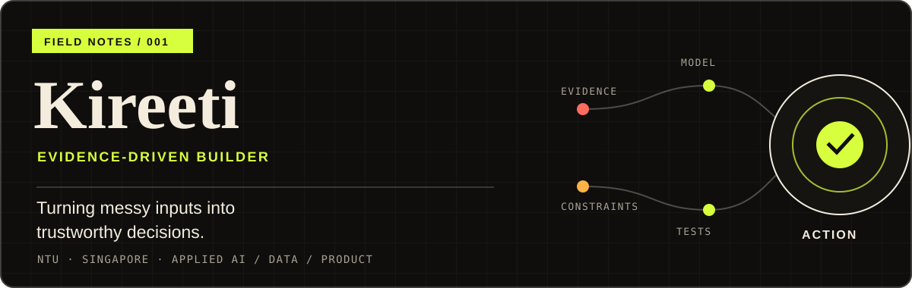

  <picture>
    <source media="(max-width: 600px)" srcset="./assets/profile-banner-mobile.svg" />
    
  </picture>

  <strong>Product-minded engineering across applied AI, data, and decision systems.</strong> 
  NTU student in Singapore · building practical, testable products for real-world problems

  <a href="https://github.com/KIREETI001/HackOrg"><strong>Start with HackOrg →</strong></a>
  &nbsp;·&nbsp;
  <a href="https://github.com/KIREETI001?tab=repositories">Explore all repositories</a>

## I like the messy part

Hi, I’m **Kireeti**. I enjoy the point where an ambiguous problem has to become a defensible product: the source data needs provenance, the model needs honest limits, and the interface needs to help someone act.

My work usually sits at the intersection of:

- **Applied AI with boundaries** — domain-aware tools where traceability and human review matter.
- **Data-to-decision systems** — models, pipelines, and dashboards that make the next step clearer.
- **End-to-end product engineering** — taking an idea from data and backend logic through interface, tests, and release checks.

## Selected systems

**01 · [HackOrg](https://github.com/KIREETI001/HackOrg)** 
A deadline-first scanner for hackathons, fellowships, and accelerators. It combines a daily Python source sweep with a focused Next.js interface, local-first preferences, data-integrity checks, and clear stale-data warnings. 
`Next.js` `Python` `GitHub Actions` `Node test runner`

**02 · [World Cup Oracle](https://github.com/KIREETI001/FIFA)** 
A hybrid football forecasting engine that blends World Football Elo with a Dixon–Coles scoreline model. Its walk-forward backtest is designed to measure performance without leaking future results into the past. 
`Python` `SciPy` `pandas` `pytest`

**03 · [NTU Academic & Career Co-Pilot](https://github.com/KIREETI001/NTU-EEE-Copilot)** 
An unofficial, version-tracked planning prototype for NTU EEE students. Academic rules live in a provenance-aware YAML rulebook, with a tested FastAPI engine and a Next.js explorer built around confidence and human review. 
`FastAPI` `Pydantic` `Next.js` `YAML`

**04 · [ALLY](https://github.com/KIREETI001/ALLY)** 
A Singapore caregiver-coordination prototype that turns discharge documents into structured care workflows. The product emphasizes source quotes, human confirmation, privacy controls, and clear boundaries around medical advice. 
`TypeScript` `Next.js` `Supabase` · [Live prototype ↗](https://ally-orcin.vercel.app)

## How I work

- **Evidence before hype.** I separate a polished prototype from validated claims and production readiness.
- **Systems, not just screens.** I connect source data, model behaviour, API contracts, user flow, and release quality.
- **Useful over flashy.** A feature earns its place when it reduces a real decision, handoff, or point of confusion.

## Working toolkit

**Build** · `Python` `TypeScript` `React` `Next.js` `FastAPI` `Vite` 
**Data & modelling** · `SQL` `pandas` `SciPy` `Jupyter` `Power BI` 
**Quality & delivery** · `pytest` `Playwright` `GitHub Actions` `Vercel` `Supabase`

## Elsewhere in the workshop

I also explore [caregiver-support software](https://github.com/KIREETI001/CareSpark), [health-data modelling](https://github.com/KIREETI001/Lifeline), and [AR learning experiences](https://github.com/KIREETI001/Digestive-System-AR).

Make the claim testable. Make the next action obvious.

